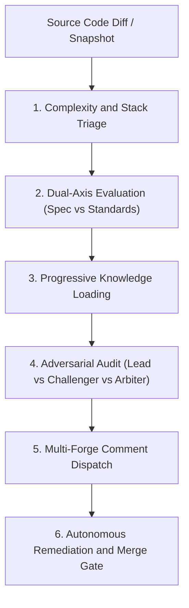

<a id="readme-top"></a>

<!-- PROJECT SHIELDS -->
<div align="center">

[![Contributors][contributors-shield]][contributors-url]
[![Forks][forks-shield]][forks-url]
[![Stargazers][stars-shield]][stars-url]
[![Issues][issues-shield]][issues-url]
[![MIT License][license-shield]][license-url]
[![Release][release-shield]][release-url]
[![Package][package-shield]][package-url]

</div>

<!-- PROJECT LOGO -->
<br />
<div align="center">
  <h1 align="center">🔍 Deep Review</h1>

  <p align="center">
    <strong>Autonomous adversarial code auditing and pull request lifecycle assistant.</strong>
    <br />
    <br />
    <a href="https://github.com/Salafite/deep-review#readme"><strong>Explore the docs »</strong></a>
    <br />
    <br />
    <a href="https://github.com/Salafite/deep-review/issues/new?labels=bug">Report Bug</a>
    ·
    <a href="https://github.com/Salafite/deep-review/issues/new?labels=enhancement">Request Feature</a>
    ·
    <a href="https://github.com/Salafite/deep-review/pkgs/npm/deep-review">View Package</a>
  </p>
</div>

<!-- TABLE OF CONTENTS -->
<details>
  <summary>Table of Contents</summary>
  <ol>
    <li>
      <a href="#about-the-project">About The Project</a>
      <ul>
        <li><a href="#key-capabilities">Key Capabilities</a></li>
        <li><a href="#built-with">Built With</a></li>
        <li><a href="#architecture">Architecture</a></li>
      </ul>
    </li>
    <li>
      <a href="#getting-started">Getting Started</a>
      <ul>
        <li><a href="#prerequisites">Prerequisites</a></li>
        <li><a href="#installation">Installation</a></li>
      </ul>
    </li>
    <li>
      <a href="#usage">Usage</a>
      <ul>
        <li><a href="#1-local-worktree-audit">Local Worktree Audit</a></li>
        <li><a href="#2-pull-request-audit">Pull Request Audit</a></li>
        <li><a href="#3-autonomous-remediation-loop">Autonomous Remediation Loop</a></li>
      </ul>
    </li>
    <li><a href="#supported-ecosystems">Supported Ecosystems</a></li>
    <li><a href="#severity-tiers">Severity Tiers</a></li>
    <li><a href="#roadmap">Roadmap</a></li>
    <li><a href="#contributing">Contributing</a></li>
    <li><a href="#license">License</a></li>
    <li><a href="#contact">Contact</a></li>
    <li><a href="#acknowledgments">Acknowledgments</a></li>
  </ol>
</details>

<!-- ABOUT THE PROJECT -->
## About The Project

**Deep Review** is an autonomous code auditing framework designed to verify pull requests, eliminate reviewer hallucinations through adversarial debate, and guide code changes from initial review to merge readiness.

### Key Capabilities

- **Two-Model Adversarial Audit**: A primary auditor proposes findings with reproducible triggers; a challenger auditor skeptically tests each claim against the code to refute false positives.
- **Dual-Axis Verification**: Independently audits **Specification Fidelity** (ensuring requirements are met without scope creep) and **Engineering Standards** (design principles and Fowler code smell baselines).
- **Progressive Domain Guides**: Selectively loads deep guidance for 20+ modern languages and frameworks without overloading the model context window.
- **Multi-Forge Integration**: Seamlessly dispatches review comments to GitHub, GitLab, and Azure DevOps, or executes entirely offline on local branches.
- **Autonomous Remediation Loop**: Harvests unresolved reviewer threads, implements verified fixes, validates against test suites, and updates discussions automatically.

<p align="right">(<a href="#readme-top">back to top</a>)</p>

### Built With

* [![Node.js][Node.js]][Node-url]
* [![Python][Python]][Python-url]
* [![GitHub Actions][GitHub-Actions]][Actions-url]
* [![Git][Git]][Git-url]

<p align="right">(<a href="#readme-top">back to top</a>)</p>

### Architecture



<p align="right">(<a href="#readme-top">back to top</a>)</p>

<!-- GETTING STARTED -->
## Getting Started

### Prerequisites

* **Node.js**: `v18.0.0` or higher
* **Python**: `v3.8` or higher
* **Git**: `v2.31.0` or higher
* *(Optional)* Forge CLI authenticated: `gh` (GitHub), `glab` (GitLab), or `az` (Azure DevOps)

### Installation

#### As an Agent Skill
```bash
npx skills add Salafite/deep-review
```

#### From GitHub Packages
```bash
npm install @salafite/deep-review
```

#### Direct Clone
```bash
git clone https://github.com/Salafite/deep-review.git .agents/skills/deep-review
```

<p align="right">(<a href="#readme-top">back to top</a>)</p>

<!-- USAGE -->
## Usage

### 1. Local Worktree Audit
Evaluate uncommitted changes or a local branch prior to publishing a pull request:

```bash
# Analyze complexity profile and detected stacks
git diff main...HEAD | python scripts/pr-analyzer.py

# Run local snapshot audit (offline, no forge token required)
node scripts/review-pr.mjs --local --base main
```

### 2. Pull Request Audit
Review active pull requests across supported platforms:

```bash
# GitHub Pull Request
node scripts/review-pr.mjs https://github.com/owner/repo/pull/123

# GitLab Merge Request
node scripts/review-pr.mjs https://gitlab.com/group/repo/-/merge_requests/45

# Azure DevOps Pull Request
node scripts/review-pr.mjs https://dev.azure.com/org/project/_git/repo/pullrequest/67

# Dry-run preview
node scripts/review-pr.mjs https://github.com/owner/repo/pull/123 --dry-run
```

### 3. Autonomous Remediation Loop
Harvest review threads across all bots and models, apply verified fixes, and resolve discussions:

```bash
# Harvest discussion threads into a structured round
bash scripts/threads.sh 123 > /tmp/round-1.json
```

<p align="right">(<a href="#readme-top">back to top</a>)</p>

<!-- SUPPORTED ECOSYSTEMS -->
## Supported Ecosystems

Deep Review bundles progressive audit guides across modern stacks:

| Category | Technologies Covered | Reference File |
|:---|:---|:---|
| **Frontend** | React 19, Server Components, TanStack Query | `reference/react.md` |
| | Vue 3.5, Composition API, Pinia | `reference/vue.md` |
| | Angular 17+, Signals, Zoneless | `reference/angular.md` |
| | Svelte 5, Runes, SvelteKit | `reference/svelte.md` |
| | TypeScript strict mode, Generics | `reference/typescript.md` |
| | Modern CSS, Less, Sass | `reference/css-less-sass.md` |
| **Backend & Systems** | Rust (ownership, unsafe, cancellation safety) | `reference/rust.md` |
| | Go (goroutines, channels, context leaks) | `reference/go.md` |
| | Python, FastAPI (Pydantic v2), Django/DRF | `reference/python.md`, `fastapi.md`, `django.md` |
| | Java 17/21 (Virtual Threads), Java 8 | `reference/java.md`, `java8.md` |
| | C# 12 / .NET 8 (EF Core, async patterns) | `reference/csharp.md` |
| | PHP 8.x, Composer, PDO | `reference/php.md` |
| | Ruby 3.4+, Rails 8 (Active Record, Jobs) | `reference/ruby.md` |
| | NestJS (DI, Guards, Interceptors) | `reference/nestjs.md` |
| | C, C++ (RAII, memory safety), Zig, Qt | `reference/c.md`, `cpp.md`, `zig.md`, `qt.md` |
| **Mobile** | Kotlin / Android (Coroutines, Compose) | `reference/kotlin.md` |
| | Swift / SwiftUI (Swift 6 Concurrency, Actors) | `reference/swift.md` |
| | Dart / Flutter (Widget rebuilds, Isolates) | `reference/dart.md` |
| **Quality & Smells** | Fowler Code Smells Baseline (12 smells) | `reference/fowler-code-smells.md` |
| **Cross-Cutting** | SQL Injection, XSS, N+1 Queries, Concurrency | `reference/cross-cutting/` |

<p align="right">(<a href="#readme-top">back to top</a>)</p>

<!-- SEVERITY TIERS -->
## Severity Tiers

Findings are mapped to standard alert blockquotes:

| Tier | Severity | Forge Alert | Description | Action Required |
|:---:|:---:|:---:|:---|:---|
| **P0** | Blocking | `[!CAUTION]` | Security flaw, data loss, auth failure, fatal crash. | Must resolve before merge. |
| **P1** | Blocking | `[!WARNING]` | Behavioral defect, contract violation, race condition. | Must resolve before merge. |
| **P2** | Non-blocking | `[!NOTE]` | Maintainability smell, performance suggestion, docs. | Author discretion. |

<p align="right">(<a href="#readme-top">back to top</a>)</p>

<!-- ROADMAP -->
## Roadmap

- [x] Two-model adversarial audit protocol
- [x] Multi-forge support (GitHub, GitLab, Azure DevOps, Local)
- [x] 20+ specialized language and framework guides
- [x] Specification fidelity vs engineering standards evaluation
- [x] Autonomous remediation loop (`threads.sh`)
- [x] GitHub Package distribution (`@salafite/deep-review`)
- [ ] Language ecosystem expansion (Elixir, Scala, Haskell)
- [ ] Pre-commit hook generator
- [ ] Interactive web transcript viewer

See the [open issues](https://github.com/Salafite/deep-review/issues) for proposed enhancements.

<p align="right">(<a href="#readme-top">back to top</a>)</p>

<!-- CONTRIBUTING -->
## Contributing

Contributions make the open source community an exceptional environment to learn, collaborate, and build. Any contributions you make are **greatly appreciated**.

1. Fork the Project
2. Create your Feature Branch (`git checkout -b feature/NewCapability`)
3. Commit your Changes (`git commit -m 'feat: add NewCapability'`)
4. Push to the Branch (`git push origin feature/NewCapability`)
5. Open a Pull Request

<p align="right">(<a href="#readme-top">back to top</a>)</p>

<!-- LICENSE -->
## License

Distributed under the MIT License. See `LICENSE` for more information.

<p align="right">(<a href="#readme-top">back to top</a>)</p>

<!-- CONTACT -->
## Contact

Salafite - [@Salafite](https://github.com/Salafite)

Project Repository: [https://github.com/Salafite/deep-review](https://github.com/Salafite/deep-review)

<p align="right">(<a href="#readme-top">back to top</a>)</p>

<!-- ACKNOWLEDGMENTS -->
## Acknowledgments

* [Best-README-Template](https://github.com/othneildrew/Best-README-Template)
* [PyDigger](https://pydigger.code-maven.com/)
* [Shields.io](https://shields.io/)

<p align="right">(<a href="#readme-top">back to top</a>)</p>

<!-- MARKDOWN LINKS & IMAGES -->
[contributors-shield]: https://img.shields.io/github/contributors/Salafite/deep-review.svg?style=for-the-badge
[contributors-url]: https://github.com/Salafite/deep-review/graphs/contributors
[forks-shield]: https://img.shields.io/github/forks/Salafite/deep-review.svg?style=for-the-badge
[forks-url]: https://github.com/Salafite/deep-review/network/members
[stars-shield]: https://img.shields.io/github/stars/Salafite/deep-review.svg?style=for-the-badge
[stars-url]: https://github.com/Salafite/deep-review/stargazers
[issues-shield]: https://img.shields.io/github/issues/Salafite/deep-review.svg?style=for-the-badge
[issues-url]: https://github.com/Salafite/deep-review/issues
[license-shield]: https://img.shields.io/github/license/Salafite/deep-review.svg?style=for-the-badge
[license-url]: https://github.com/Salafite/deep-review/blob/main/LICENSE
[release-shield]: https://img.shields.io/github/v/release/Salafite/deep-review?style=for-the-badge&color=blue
[release-url]: https://github.com/Salafite/deep-review/releases
[package-shield]: https://img.shields.io/badge/GitHub_Packages-npm-cb3837?style=for-the-badge&logo=npm&logoColor=white
[package-url]: https://github.com/Salafite/deep-review/pkgs/npm/deep-review
[Node.js]: https://img.shields.io/badge/Node.js-339933?style=for-the-badge&logo=nodedotjs&logoColor=white
[Node-url]: https://nodejs.org/
[Python]: https://img.shields.io/badge/Python-3776AB?style=for-the-badge&logo=python&logoColor=white
[Python-url]: https://www.python.org/
[GitHub-Actions]: https://img.shields.io/badge/GitHub_Actions-2088FF?style=for-the-badge&logo=github-actions&logoColor=white
[Actions-url]: https://github.com/features/actions
[Git]: https://img.shields.io/badge/Git-F05032?style=for-the-badge&logo=git&logoColor=white
[Git-url]: https://git-scm.com/
