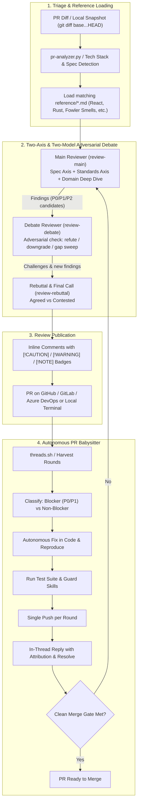

---
name: deep-review
description: "Unified two-model adversarial debate code review and autonomous PR babysitter with 20+ specialized language ecosystems (React 19, Vue 3, Angular 17+, Svelte 5, Rust, TypeScript, Go, Python, Java 17/21, FastAPI, etc.), two-axis Spec & Standards verification with Fowler smell baseline, and cross-cutting guides (security, performance, architecture, N+1, concurrency). Use for reviewing PRs/MRs, local branches, or automated review babysitting."
license: MIT
compatibility: Node 18+, Python 3.8+, Git 2.31+. Optional forge CLIs `gh`, `glab`, `az`.
metadata:
  version: 1.1.0
---

# Deep Review & Autonomous PR Babysitter

A unified, expert-level code review system combining:
1. **Two-Axis Isolation (Spec vs. Standards)**: Evaluates the diff independently against the originating business spec (missing requirements, scope creep, contract mismatches) and code standards (repo rules + the 12 Fowler code smells baseline). One axis cannot mask the other.
2. **Adversarial Two-Model Debate**: A main reviewer finds concrete issues, a skeptical debate reviewer attempts to knock them down or identify blind spots, and a final rebuttal call settles the review. Eliminates false positives and AI hallucinations before anything is posted.
3. **20+ Language Ecosystems & Cross-Cutting Knowledge Base**: Deep review guides for React 19, Vue 3.5, Angular 17+, Svelte 5, Rust, TypeScript, Java 17/21, Java 8, PHP 8, Ruby/Rails 8, Python, Django, FastAPI, Go, Kotlin, Swift, Dart/Flutter, NestJS, C/C++, Zig, Qt, CSS/Less/Sass, plus architecture, security, N+1 queries, async concurrency, and universal anti-patterns.
4. **Multi-Forge & Local CLI**: Works seamlessly across GitHub (`gh`), GitLab (`glab`), Azure DevOps (`az`), or local git trees (`--local`) without forge dependencies.
5. **Autonomous PR Babysitter Loop**: Harvests inline threads and bot reviews, classifies real impact, reproduces issues, fixes blockers autonomously in code, runs test suites and guard skills, pushes once per round, replies in-thread with attribution, and resolves threads until the clean merge gate is met.



---

## When to Use This Skill

- **Full PR / MR Review**: Review a GitHub PR, GitLab MR, or Azure DevOps PR with two-model adversarial rigor.
- **Local Pre-PR Review**: Review a feature branch, dirty working tree, or staged commits before opening a pull request (`--local` or fixed point `base...HEAD`).
- **Two-Axis Conformance Audit**: Verify whether changes implement the originating issue/spec accurately while adhering to repository coding standards and Fowler code smell baselines.
- **Domain-Specific Deep Review**: Reviewing specialized codebases (e.g., React 19 RSC, Rust unsafe/async cancellation, Go channels/context leaks, FastAPI Pydantic v2 validation, Java Virtual Threads, N+1 database queries).
- **Autonomous PR Babysitting**: Watch and work a PR through multiple bot/human review rounds until all blockers are resolved and verified.

---

## The Two Review Axes: Spec vs. Standards

A change can pass one axis and fail the other:
- *Code that follows every standard but implements the wrong thing* $\rightarrow$ **Standards pass, Spec fail.**
- *Code that does exactly what the issue asked but introduces technical debt and smells* $\rightarrow$ **Spec pass, Standards fail.**

Reporting them separately stops one axis from masking the other.

### Axis 1: The Spec Axis
Compares the diff (`git diff <base>...HEAD`) against the originating spec (discovered from issue references `#123`, PR body, or `--spec <file>`):
1. **Missing or Partial Requirements**: Items explicitly asked for that are absent.
2. **Scope Creep**: Behavior or changes in the diff that were not requested.
3. **Contract / Logic Errors**: Requirements that appear implemented but where the implementation is factually incorrect.

### Axis 2: The Standards Axis & Fowler Smell Baseline
Compares the diff against documented repository rules (`CODING_STANDARDS.md`, `CONTRIBUTING.md`, `CLAUDE.md`, `AGENTS.md`) and the **12 Fowler Code Smells Baseline** ([`reference/fowler-code-smells.md`](reference/fowler-code-smells.md)):

| Smell | What It Is | How To Fix |
|:---|:---|:---|
| **Mysterious Name** | Unclear function, variable, or type name. | Rename for intent; if difficult, clarify responsibility. |
| **Duplicated Code** | Similar logic repeated in multiple hunks/files. | Extract shared function/module and reuse. |
| **Feature Envy** | Method accesses another object's data more than its own. | Move method to the data, or pass required behavior. |
| **Data Clumps** | Same group of 3+ fields/params passing together. | Bundle into a dedicated struct, class, or type. |
| **Primitive Obsession** | Basic primitives representing rich domain concepts. | Introduce value objects or branded types. |
| **Repeated Switches** | Identical `switch`/`if` cascades across functions. | Replace with polymorphism or shared lookup map. |
| **Shotgun Surgery** | One logical change forces edits across many files. | Consolidate related logic into one module. |
| **Divergent Change** | Single module edited for multiple unrelated reasons. | Split into single-responsibility classes. |
| **Speculative Generality**| Unused abstractions or hooks for future needs. | YAGNI: Remove speculative hooks and inline. |
| **Message Chains** | Long chained calls (`a.b().c().d()`). | Law of Demeter: Hide behind delegate method. |
| **Middle Man** | Class that mostly delegates to another. | Remove middle man and call target directly. |
| **Refused Bequest** | Subclass ignores or stubs most inherited methods. | Replace inheritance with composition. |

*Rule:* Documented repository standards always override baseline heuristics.

---

## Core Workflows

### Workflow 1: Local Working Tree Review (Pre-PR)

Review your current working changes before opening a pull request. Runs on a clean snapshot clone; never touches or alters your working tree:

```bash
# Analyze complexity and affected tech stacks
git diff main...HEAD | python "<skill-dir>/scripts/pr-analyzer.py"

# Run two-model debate review on local tree (outputs to console, no forge needed)
node "<skill-dir>/scripts/review-pr.mjs" --local [--base main] [--spec <path-to-spec-or-issue>]
```

### Workflow 2: Live Forge PR Review

Review a pull request and post inline alert comments (`[!CAUTION]`, `[!WARNING]`, `[!NOTE]`):

```bash
# GitHub PR
node "<skill-dir>/scripts/review-pr.mjs" https://github.com/owner/repo/pull/123

# GitLab MR
node "<skill-dir>/scripts/review-pr.mjs" https://gitlab.com/group/repo/-/merge_requests/45

# Azure DevOps PR
node "<skill-dir>/scripts/review-pr.mjs" https://dev.azure.com/org/proj/_git/repo/pullrequest/67

# Dry-run (prints the review without posting to the forge)
node "<skill-dir>/scripts/review-pr.mjs" https://github.com/owner/repo/pull/123 --dry-run
```

### Workflow 3: Autonomous PR Babysitting Loop

Carry a PR from initial review to ready-to-merge:

```bash
# 1. Harvest open review threads across all bots and reviewers
"<skill-dir>/scripts/threads.sh" <PR_NUMBER> > /tmp/round-1.json

# 2. Inspect threads, classify blockers, reproduce and fix in code
# 3. Verify with repo tests and guard skills (clean-code-guard, test-guard)
# 4. Commit and push once per round
# 5. Reply in-thread with attribution:
#    "I am <model> writing on behalf of <user>."
# 6. Resolve threads and re-run review until clean merge gate is met
```

---

## The Four-Phase Review Process

When conducting a review (manually or via the debate engine), follow this structured sequence:

### Phase 1: Context Gathering & Triage
1. Run `git diff <base>...HEAD | python <skill-dir>/scripts/pr-analyzer.py` to identify:
   - Diff size, lines changed, file spread.
   - Technologies detected (e.g. `react`, `rust`, `python`, `sql`).
2. Read the PR description and linked issue / spec (`--spec <file>`).
3. Check repository standards (`CONTRIBUTING.md`, `CLAUDE.md`, `CODING_STANDARDS.md`).

### Phase 2: High-Level Architecture & Performance
1. **Architecture fit**: SOLID principles, boundary crossings, unintended coupling. See [`reference/architecture-review-guide.md`](reference/architecture-review-guide.md).
2. **Performance impact**: Algorithmic complexity, memory allocations, N+1 query patterns. See [`reference/performance-review-guide.md`](reference/performance-review-guide.md) and [`reference/cross-cutting/n-plus-one-queries.md`](reference/cross-cutting/n-plus-one-queries.md).
3. **Security surface**: Input validation, auth boundaries, injection vulnerabilities. See [`reference/security-review-guide.md`](reference/security-review-guide.md).

### Phase 3: Line-by-Line Deep Review
Load the specific language guide from [`reference/`](reference/) and audit:
- **Spec fidelity**: Does each hunk accurately satisfy requirements without scope creep?
- **Standards & smells**: Does each hunk maintain naming clarity, avoid duplication, and adhere to Fowler smell principles?
- **Every hunk line-by-line**: Check input, state, concurrency, timing, or configuration edge cases.
- **Every deleted or replaced line**: Identify the invariant it enforced, and confirm where the new code re-establishes it.
- **Every changed signature/contract**: Grep callers to ensure precondition, return shape, and exception changes are handled.
- **Universal anti-patterns**: Parameter sprawl, leaky abstractions, TOCTOU race conditions, redundant state, no-op updates. See [`reference/code-quality-universal.md`](reference/code-quality-universal.md).

### Phase 4: Adversarial Debate & Verdict
- **Main Reviewer (`review-main`)**: Drafts candidates with concrete triggers and observable wrong results.
- **Debate Reviewer (`review-debate`)**: Attempts to disprove (`refute`) with code proof, downgrade overstatements (`downgrade`), or add unspotted critical blockers (`new_findings`).
- **Rebuttal (`review-rebuttal`)**: Main reviewer settles each contested claim.

---

## Severity Tiers & Forge Alert Badges

| Severity | Label | Forge Alert | Description | Action Required |
|:---:|:---:|:---:|:---|:---|
| **P0** | `blocking` | `[!CAUTION]` | Critical security vulnerability, data loss, auth bypass, severe crash. | Must fix before merge. |
| **P1** | `blocking` | `[!WARNING]` | Functional defect, broken edge case, contract violation, race condition. | Must fix before merge. |
| **P2** | `non-blocking` | `[!NOTE]` | Code smell, maintainability, minor performance optimization, missing doc. | Addressed at author's discretion. |
| - | `suggestion` | `💡` | Alternative design or educational insight. | Optional. |
| - | `praise` | `🎉` | Exemplary pattern or clean implementation. | Encouragement. |

---

## Autonomous Babysitting Rules

When executing the babysitting loop:
1. **Verify Before Believing**: Review bot and model comments are claims to check against code. Reproduce first.
2. **Publish Before Answering**: A "fixed" reply is only true once the remote branch carries the commit. Never resolve a thread with unpushed local changes.
3. **One Push Per Round**: Consolidate all blocker fixes into a single commit and push once to avoid redundant bot re-triggers.
4. **Transparent Attribution**: Open every reply naming the model and the user:
   > I am `<model>` writing on behalf of `<user>`.
5. **Clean Merge Gate**: The PR is merge-ready only when all blocking threads are resolved, CI is passing, and the latest commit has received a clean review round with zero unresolved blockers.

---

## Comprehensive Reference Catalog

The skill includes over 21,000 lines of curated language guides in `reference/`:

### Core Quality & Smells
- **Fowler Code Smells**: [`reference/fowler-code-smells.md`](reference/fowler-code-smells.md) – The 12 classic code smells, detection heuristics, and refactoring techniques.
- **Universal Quality**: [`reference/code-quality-universal.md`](reference/code-quality-universal.md) – Reuse audit, parameter sprawl, leaky abstractions, TOCTOU, redundant state.
- **Common Bugs Checklist**: [`reference/common-bugs-checklist.md`](reference/common-bugs-checklist.md) – Language-specific bug patterns and pitfalls.

### Frontend
- **React 19 / Next.js**: [`reference/react.md`](reference/react.md) – `useActionState`, `useOptimistic`, Server Components, Actions, TanStack Query v5.
- **Vue 3.5**: [`reference/vue.md`](reference/vue.md) – Composition API, Reactivity system, Props/Emits, Composables.
- **Angular 17+**: [`reference/angular.md`](reference/angular.md) – Signals, Standalone components, Zoneless change detection, RxJS.
- **Svelte 5**: [`reference/svelte.md`](reference/svelte.md) – Runes (`$state`, `$derived`), SvelteKit form actions, SSR boundaries.
- **TypeScript**: [`reference/typescript.md`](reference/typescript.md) – Strict mode, generics, type narrowing, immutable patterns.
- **CSS / Less / Sass**: [`reference/css-less-sass.md`](reference/css-less-sass.md) – Responsive layout, CSS variables, specificity.

### Backend & Systems
- **Rust**: [`reference/rust.md`](reference/rust.md) – Ownership, borrowing, `unsafe` safety contracts, async cancellation.
- **Go**: [`reference/go.md`](reference/go.md) – Goroutine lifecycle, channel patterns, `context` propagation, interface design.
- **Python / FastAPI / Django**:
  - Python: [`reference/python.md`](reference/python.md) – Mutable defaults, type annotations, pytest patterns.
  - FastAPI: [`reference/fastapi.md`](reference/fastapi.md) – Depends, Pydantic v2 validation, async sessions.
  - Django / DRF: [`reference/django.md`](reference/django.md) – Query optimization, serializers, security.
- **Java**:
  - Java 17/21 & Spring Boot 3: [`reference/java.md`](reference/java.md) – Records, Virtual Threads, Spring Boot 3 JPA.
  - Java 8 & Spring Boot 2: [`reference/java8.md`](reference/java8.md) – Legacy patterns, thread pools, javax.*.
- **C# / .NET 8**: [`reference/csharp.md`](reference/csharp.md) – C# 12 features, EF Core performance, ASP.NET Core async.
- **PHP 8.x**: [`reference/php.md`](reference/php.md) – Strict types, PDO, Composer security, PHPStan.
- **Ruby / Rails 8**: [`reference/ruby.md`](reference/ruby.md) – Rails 8 conventions, Active Record, Active Job.
- **NestJS**: [`reference/nestjs.md`](reference/nestjs.md) – Dependency injection, Guards, Interceptors, DTO validation.
- **C / C++**:
  - C: [`reference/c.md`](reference/c.md) – Pointer safety, buffer bounds, undefined behavior, cleanup.
  - C++: [`reference/cpp.md`](reference/cpp.md) – RAII, smart pointers, Rule of 0/3/5, exception safety.
- **Zig**: [`reference/zig.md`](reference/zig.md) – Allocator ownership, error handling, `comptime`.
- **Qt**: [`reference/qt.md`](reference/qt.md) – Object ownership tree, thread-safe signal/slots.

### Mobile
- **Kotlin / Android**: [`reference/kotlin.md`](reference/kotlin.md) – Coroutines, StateFlow, Jetpack Compose, leak prevention.
- **Swift / SwiftUI**: [`reference/swift.md`](reference/swift.md) – Swift 6 Concurrency, actors, `Sendable`, SwiftUI state.
- **Dart / Flutter**: [`reference/dart.md`](reference/dart.md) – Widget rebuilds, const constructors, null safety, isolates.

### Cross-Cutting Guides
- **Architecture**: [`reference/architecture-review-guide.md`](reference/architecture-review-guide.md)
- **Performance**: [`reference/performance-review-guide.md`](reference/performance-review-guide.md)
- **Security**: [`reference/security-review-guide.md`](reference/security-review-guide.md)
- **SQL Injection Prevention**: [`reference/cross-cutting/sql-injection-prevention.md`](reference/cross-cutting/sql-injection-prevention.md)
- **XSS Prevention**: [`reference/cross-cutting/xss-prevention.md`](reference/cross-cutting/xss-prevention.md)
- **N+1 Queries**: [`reference/cross-cutting/n-plus-one-queries.md`](reference/cross-cutting/n-plus-one-queries.md)
- **Error Handling Principles**: [`reference/cross-cutting/error-handling-principles.md`](reference/cross-cutting/error-handling-principles.md)
- **Async & Concurrency Patterns**: [`reference/cross-cutting/async-concurrency-patterns.md`](reference/cross-cutting/async-concurrency-patterns.md)
- **Communication & Review Best Practices**: [`reference/code-review-best-practices.md`](reference/code-review-best-practices.md)
