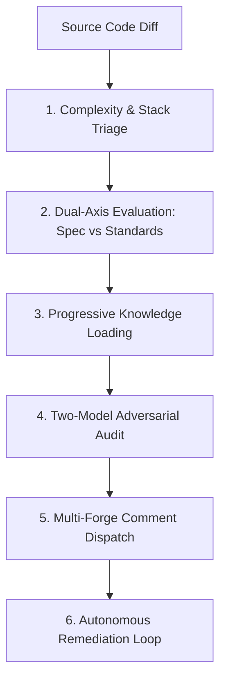

---
name: deep-review
description: Autonomous adversarial code auditor and pull request lifecycle assistant. Combines multi-agent debate verification, domain-specific rule evaluations across modern language ecosystems, and self-directed remediation cycles.
license: MIT
compatibility: Node.js 18+, Python 3.8+, Git 2.31+. Compatible with GitHub, GitLab, Azure DevOps, and local repositories.
metadata:
  version: 2.0.0
---

# Deep Review

An autonomous code auditing framework designed to verify pull requests, reduce reviewer false positives, and streamline code review resolution.

## Architectural Overview

Deep Review operates on a multi-stage audit pipeline:



### Stage 1: Complexity & Stack Triage
Inspects incoming code diffs to determine modified file patterns, language composition, algorithmic complexity, and surface area risk.

### Stage 2: Dual-Axis Evaluation
Analyzes code along two independent dimensions:
1. **Specification Integrity**: Ensures implementation matches intended requirements without scope creep or missed constraints.
2. **Engineering Standards**: Enforces design principles, modularity, and clean code heuristics.

### Stage 3: Progressive Knowledge Loading
Selectively imports specialized domain guidance based on detected technology stacks (e.g., React, Rust, Go, Python, Java) and cross-cutting concerns (concurrency, security, query optimization).

### Stage 4: Two-Model Adversarial Audit
- **Primary Auditor**: Identifies potential defects, security exposures, or behavioral anomalies with reproducible triggers.
- **Challenger Auditor**: Skeptically probes each finding against the broader codebase to refute false positives, confirm validity, or adjust severity.
- **Arbiter**: Delivers final consensus on agreed vs. contested findings.

### Stage 5: Multi-Forge Comment Dispatch
Formats and publishes actionable feedback as native alert blockquotes on GitHub, GitLab, or Azure DevOps, or outputs directly to terminal in offline mode.

### Stage 6: Autonomous Remediation Loop
Harvests discussion threads, validates reported defects against source code, applies verified fixes, verifies test suites, and resolves threads autonomously.

## Command Reference

### Local Snapshot Review
```bash
node scripts/review-pr.mjs --local --base main
```

### Remote Pull Request Review
```bash
node scripts/review-pr.mjs <pr-or-mr-url> [--dry-run]
```

### Remediate Review Cycles
```bash
bash scripts/threads.sh <pr-number>
```
